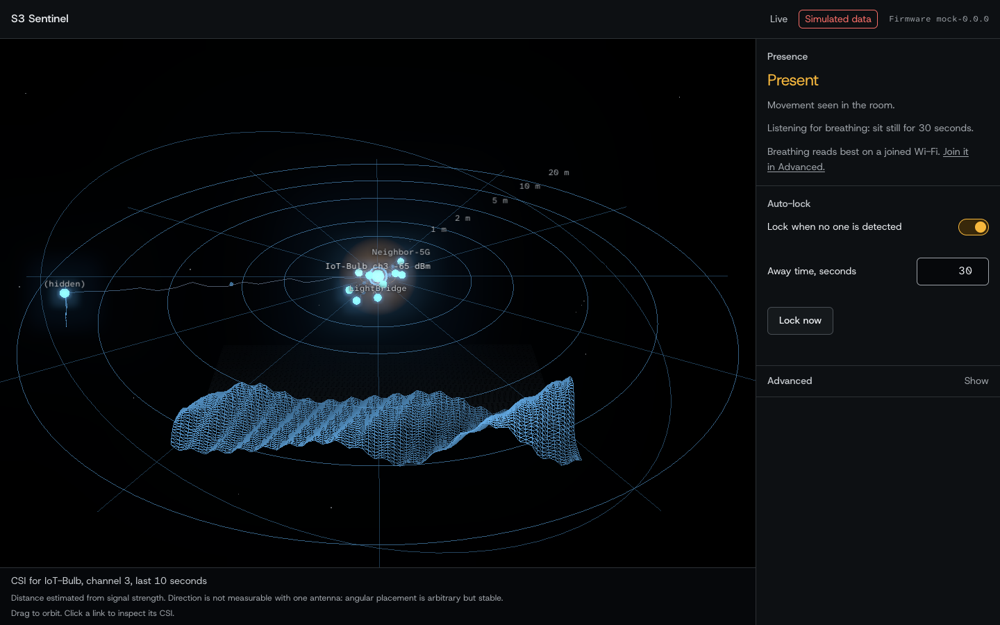
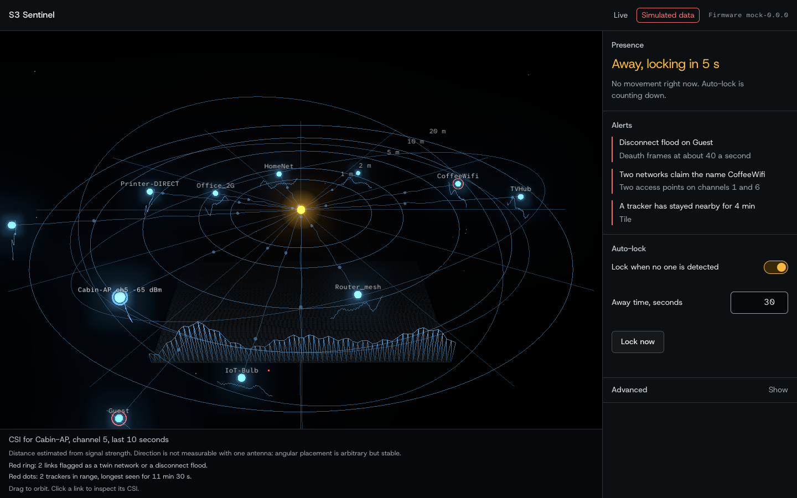
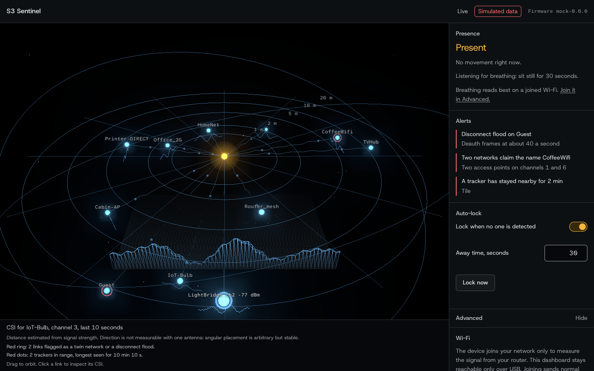

# S3 Sentinel

[](https://github.com/AieatAssam/esp32-sentinel/actions/workflows/build.yml)

S3 Sentinel is open-source firmware for an ESP32-S3 USB dongle. The host sees three things
from it: a USB network interface with a dashboard at `http://192.168.7.1`, a FIDO2/U2F
security key, and a keyboard that sends the lock shortcut. The device also watches the Wi-Fi
and Bluetooth radio around it, estimates whether someone is nearby, and can lock the host
when nobody is.

> **Experimental, uncertified security project.** S3 Sentinel is a hobby-stage project. It
> has not been audited, certified, or independently tested. Its presence estimate is a
> heuristic, and its FIDO key has no trusted attestation. Do not use it to protect anything
> that matters.

Version 0.1.0, unreleased. Developed and tested on one board, on one host operating system
(macOS). See [Limitations](#limitations).



*The dashboard in simulated-data mode (`?mock=1`). The "Simulated data" badge and the network
names come from `web/js/mock.js`. They are not a scan of any real network.*

## What it does

- **Presence and auto-lock.** Estimates presence from Wi-Fi channel state information (CSI)
  and beacon signal strength, with an optional breathing estimate and an optional empty-room
  baseline. When the room has been empty for the away time and auto-lock is on, it sends the
  lock shortcut to the host. See [docs/SENSING.md](docs/SENSING.md).
- **Radio threat view.** Flags bursts of deauthentication frames, access points that may be
  evil twins or spoofed, and nearby Bluetooth tracker advertisements (AirTag, Find My, Tile,
  SmartTag). See [docs/SENSING.md](docs/SENSING.md#threats).
- **3D radio scene.** The dashboard draws the access points and trackers around the device in
  three dimensions, with a live CSI view for a selected network. Distances come from signal
  strength; the direction of each network is not measured.
- **FIDO2 and U2F key.** CTAP 2.1 over USB HID, with ES256 credentials, resident keys, a PIN,
  credential management, and the hmac-secret extension. User presence is a press of the BOOT
  button. See [docs/FIDO.md](docs/FIDO.md).
- **Dashboard.** A web page served from the device over USB, with a live feed over WebSocket
  at 10 Hz. Advanced settings, the Wi-Fi join, and the security key sit under "Advanced".
- **Recovery.** A boot-loop counter, a safe mode in release builds, and core dumps written to
  a flash partition. See [docs/ARCHITECTURE.md](docs/ARCHITECTURE.md).

Screenshots of the other two dashboard states, both with simulated data:

| Alerts (`?mock=1&alerts=1`) | Advanced panel open |
|---|---|
|  |  |

## Hardware

- An ESP32-S3 module with 16 MB flash and 8 MB octal PSRAM. The configuration is written for
  this layout.
- A BOOT button on GPIO 0, and an addressable status LED on GPIO 48 (or GPIO 38).
- A USB data connection to the host.

The tested board is described in [docs/HARDWARE.md](docs/HARDWARE.md). Other ESP32-S3 boards
are untested, and a board with less flash or without octal PSRAM needs changes to
`partitions.csv` and `sdkconfig.defaults`.

## Quick start

There are two ways to install. Both write the same release firmware.

### Option 1: browser flasher

Open **https://aieatassam.github.io/esp32-sentinel/** in Chrome or Edge on a desktop computer.
The page uses the Web Serial API, which other browsers and phones do not provide.

1. Put the board in download mode: hold BOOT, tap RESET (or plug the board in while holding
   BOOT), then release BOOT.
2. Choose **Install release build** and select the serial port.

The page also offers a development build. Use it only on a test board; see
[Builds](#builds).

### Option 2: release binary and esptool

Each `v*` tag publishes the [release](https://github.com/AieatAssam/esp32-sentinel/releases)
build as a whole image, `s3-sentinel-release.bin`, and as three parts that update a device
without touching its settings. The development build (`s3-sentinel-dev.bin` and its parts) is
secondary and is for developers only. Check each file against its checksum file before flashing:

```sh
sha256sum -c s3-sentinel-release.bin.sha256
sha256sum -c s3-sentinel-release.parts.sha256
```

Install [esptool](https://docs.espressif.com/projects/esptool/) and put the board in download
mode as above.

To **update** a device and keep its settings, Wi-Fi and FIDO credentials, write the three parts
at their offsets:

```sh
esptool --chip esp32s3 --port /dev/cu.usbmodemXXXX --flash-mode dio --flash-freq 80m --flash-size 16MB \
  write-flash 0x0 s3-sentinel-release-bootloader.bin \
  0x8000 s3-sentinel-release-partition-table.bin \
  0x20000 s3-sentinel-release-app.bin
```

For a **clean install**, write the whole image at offset 0. This resets the settings partition,
so settings, the Wi-Fi password and the FIDO credentials and PIN are lost:

```sh
esptool --chip esp32s3 --port /dev/cu.usbmodemXXXX write-flash 0x0 s3-sentinel-release.bin
```

Use the port name your system shows.

### Build from source

See [docs/BUILDING.md](docs/BUILDING.md). In short, with ESP-IDF v6.0.1 sourced:

```sh
idf.py -B build_rel -D SDKCONFIG=build_rel/sdkconfig -D SDKCONFIG_DEFAULTS="sdkconfig.defaults" build
BUILD="$PWD/build_rel" tools/flash.sh
```

`tools/flash.sh` needs a device backup at `backup/original-flash-0x0-0x200000.bin`, which is
not in the repository, unless `FORCE_NO_BACKUP=1` is set. It writes the bootloader, the
partition table and the application, and it does not write the settings partition. See
[Flashing](docs/BUILDING.md#flashing).

## First run

1. **Connect.** Plug the board into the host over USB. The device presents a network interface
   at `192.168.7.1` and a keyboard and security-key interface.
2. **Open the dashboard.** Browse to `http://192.168.7.1`. The address is reachable only over
   the USB network interface. Every request must carry `Host: 192.168.7.1`, so use the address
   itself, not a name.
3. **Wait for presence.** The presence panel starts with a passive estimate. It sits in "listening
   for breathing" until a Wi-Fi network is joined.
4. **Optional: join Wi-Fi.** Under Advanced, join a network. Breathing estimates (experimental) can
   read only while the device is joined and the room is still. The password is stored on the device.
5. **Calibrate with the room empty.** Under Advanced, record the empty-room baseline if you want
   it used in presence (`use_baseline`).
6. **Set up the security key.** Under Advanced, "Security key" shows whether a PIN is set and how
   many attempts remain. See [docs/FIDO.md](docs/FIDO.md#pin) for how the PIN is stored.
7. **Enable auto-lock last.** Test the lock shortcut on a scratch document first. The keystroke
   goes to whichever application has focus (see [Lock shortcut](#lock-shortcut)).

## Builds

There are three build configurations, all described in [docs/BUILDING.md](docs/BUILDING.md#build-configurations).

| Build | Defaults | Published | Use |
|---|---|---|---|
| Release | `sdkconfig.defaults` | Yes, as `s3-sentinel-release.bin` | The firmware to use |
| Development (for developers) | `sdkconfig.defaults;sdkconfig.dev` | Yes, as `s3-sentinel-dev.bin` (secondary) | Enables `CONFIG_DEV_BACKDOOR`: the `/api/log` route, vendor security-key commands `0x51` and `0x52`, and download mode over HTTP without a BOOT hold |
| Test | `sdkconfig.defaults;sdkconfig.dev;sdkconfig.test` | No | Used by `tools/fido_test.py`. Grants security-key presence without a press |

Do not flash a development or test build onto a device that holds credentials you need.

## Settings and credentials

Settings, the Wi-Fi password and the FIDO credentials live in the NVS partition at `0x9000`.

- **Updating** (the browser flasher without erase, the three parts with esptool, or
  `tools/flash.sh`) writes the bootloader, the partition table and the application, and not NVS.
  Settings, the Wi-Fi password and the FIDO credentials and PIN are kept, as long as
  `partitions.csv` is unchanged. This follows from the partition table. It was not re-tested on a
  device for this release.
- **Clean install** (the browser flasher with erase, or the whole merged image at `0x0`) resets the
  settings partition. **The settings, the Wi-Fi password, the FIDO credentials and the PIN are
  removed.** Sites where the security key was registered will stop accepting it until you register
  it again.
- A full chip erase, or `POST /api/fido/reset`, also removes FIDO credentials and the PIN.
- `POST /api/fido/harden` burns eFuses and cannot be reversed. It runs only when you start it in
  the dashboard. See [docs/FIDO.md](docs/FIDO.md#master-secret-reset-and-hardening).

Flashing never burns eFuses on its own.

## Security model

- The dashboard listener accepts only the USB network address. Requests from other addresses
  and Wi-Fi clients are refused. Writes need the device's own `Origin` and a JSON body.
- Settings are validated on write. Changes reach flash at most once per second.
- The FIDO PIN is stored as part of a SHA-256 digest, encrypted and authenticated under keys
  derived from the master secret. Without flash encryption, a flash dump allows offline guessing
  of the PIN.
- The master secret is plaintext in NVS until hardening. There is no flash encryption and no
  secure boot in the default configuration.
- Self-signed FIDO attestation: relying parties cannot verify the device's make.

[SECURITY.md](SECURITY.md) explains the checks and their reasons. Report vulnerabilities through
a private advisory, not an issue.

## Limitations

- **One board, one host.** Developed and tested on one unidentified ESP32-S3 board, on macOS.
  The USB network interface, the lock shortcut and the host tools are untested on Linux and
  Windows. The `win` and `linux` lock options both send Super+L and are untested.
- **Presence is a heuristic.** It has not been measured against ground truth in this repository,
  and it can be wrong in either direction. Pets, fans and people in the room change it, and moving
  the device changes the baseline.
- **Breathing is experimental and has not been seen to work.** The estimate can read only while
  the device is joined to a Wi-Fi network and a 30-second window passes the gates in
  [docs/SENSING.md](docs/SENSING.md#breathing-gates). In the one recorded test (a person about
  1 m away, working at a laptop) no breathing signal rose above noise, so it stays hidden; see
  [docs/SENSING.md](docs/SENSING.md#breathing-what-was-measured). It is not a medical measurement.
- **Not a certified security key.** The FIDO implementation is not certified. Attestation is
  self-signed.
- **Browser flasher is untested on hardware.** The page was written from the build and flash
  scripts. Check the result on your board before relying on it.
- **CI has not run yet.** The workflows are new. Their first run tests the container tag, the
  paths and the action versions.

More detail is in [docs/SENSING.md](docs/SENSING.md#limitations) and [docs/FIDO.md](docs/FIDO.md).

## Lock shortcut

The lock keystroke goes to whichever application has focus on the host. It is `Ctrl+Cmd+Q` for
`mac`, and `Super+L` for `win` and `linux`. A wrong `lock_os` setting sends a keystroke the host
may not expect. Test the setting on a scratch document before enabling auto-lock.

## Configuration

Stored in NVS and changed through `POST /api/config`. Values are validated on write. Writes are
coalesced: a write reaches flash at most once per second.

| Field | Default | Allowed | Meaning |
|---|---|---|---|
| `autolock` | `false` | boolean | Send the lock shortcut when away |
| `away_secs` | `30` | 5 to 600 | Seconds without presence before "away" |
| `motion_threshold` | `0.15` | 0.0 to 1.0 | Motion score that counts as presence |
| `lock_os` | `"mac"` | `mac`, `win`, `linux` | Which lock shortcut to send |
| `led_gpio` | `48` | 38 or 48 | Status LED pin |
| `led_brightness` | `32` | 0 to 255 | Status LED brightness |
| `channel` | `0` | 0 (automatic) or 1 to 13 | Wi-Fi channel to watch |
| `use_breathing` | `true` | boolean | Count breathing as presence |
| `use_baseline` | `false` | boolean | Use the empty-room baseline in presence |

The full endpoint table is in [docs/ARCHITECTURE.md](docs/ARCHITECTURE.md#rest-endpoints).

## Testing

- Host C tests (`tools/*_test.c`): commands in [docs/BUILDING.md](docs/BUILDING.md#host-tests).
- Dashboard: `node --check web/js/*.js`, and the simulated mode.
- Device: `tools/ws_check.py` checks the live feed against its frame contract.
  `tools/fido_test.py` needs the test build.

CI runs the host tests, the dashboard check, and both firmware builds on every push and pull
request. See `.github/workflows/build.yml`.

## Project layout

```
main/        firmware (ESP-IDF component)
main/fido/   FIDO2, U2F, CTAPHID, credential store
web/         dashboard (static files, embedded in the firmware at build time)
flasher/     browser flasher page for GitHub Pages
tools/       host tools and host-side C tests
patches/     upstream fix applied to the TinyUSB component at configure time
docs/        architecture, sensing, FIDO, building, hardware
licenses/    license texts for bundled third-party code
```

## Contributing

See [CONTRIBUTING.md](CONTRIBUTING.md), [CODE_OF_CONDUCT.md](CODE_OF_CONDUCT.md), and
[SECURITY.md](SECURITY.md).

## Credits

S3 Sentinel uses ESP-IDF, TinyUSB, NimBLE, cJSON, TinyCBOR, three.js, and two fonts. Their
licenses are listed in [THIRD_PARTY_NOTICES.md](THIRD_PARTY_NOTICES.md).

## Licence

MIT. See [LICENSE](LICENSE).
